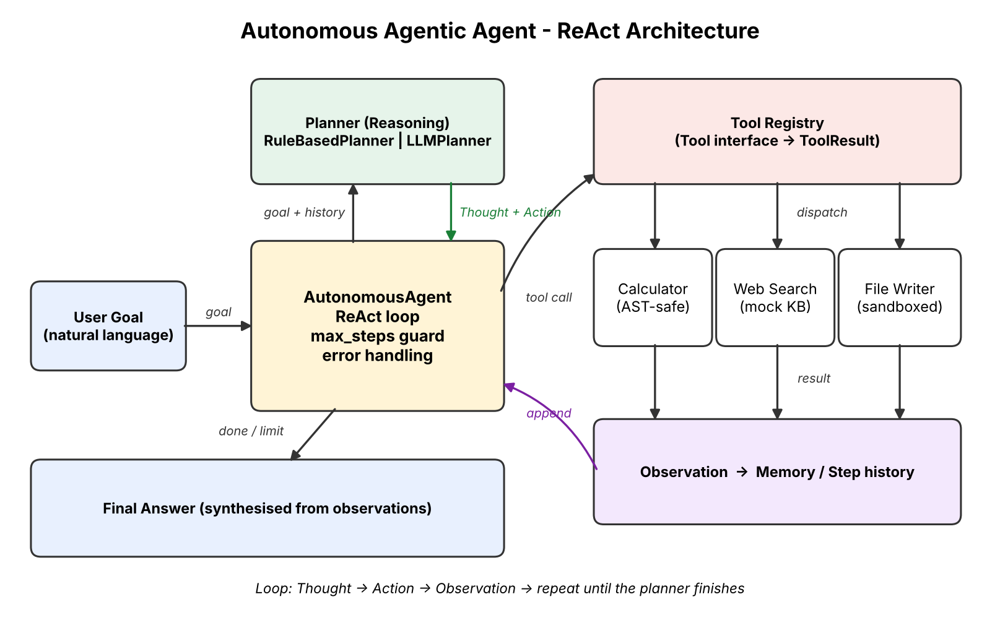
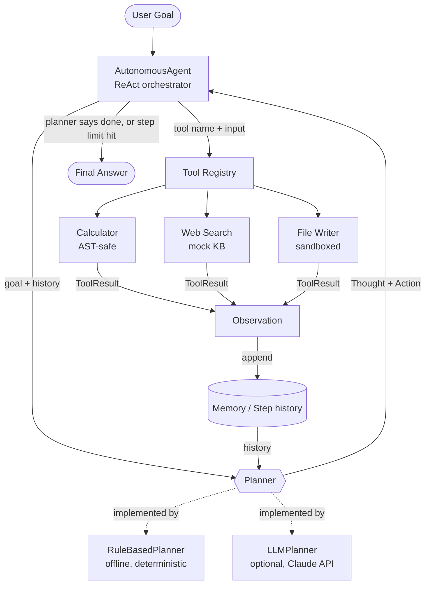

# Autonomous Agentic Agent (AI Assignment)

## Project Overview

This project implements an autonomous agent built on the **ReAct (Reason + Act)** framework. Given a natural-language goal, the agent:

1. **Reasons** about what to do next (Thought),
2. **Acts** by selecting and running a tool: Calculator, Web Search or File Writer (Action),
3. **Observes** the result and feeds it back into its reasoning (Observation),
4. repeats until the goal is complete, then **synthesizes** a final answer.

Goals can be **multi-step**: `calculate (12 + 8) * 5, search AI agent trends 2026 and save the results to report.txt` runs three tools in sequence, and the file writer saves the earlier observations.

## System Schema & Architecture





```
          +-------------------------------------------------+
 Goal --> |  AutonomousAgent  (loop, max_steps, memory)     |
          |                                                 |
          |   +---------+  Thought/Action  +-------------+  |
          |   | Planner | ---------------> | ToolRegistry|  |
          |   |  rules  |                  | calc | search|  |
          |   |  or LLM | <--------------- | file_writer |  |
          |   +---------+   Observation    +-------------+  |
          +-------------------------+-----------------------+
                                    |
                                    v
                              Final Answer
```

### Components

| Component | Responsibility |
|---|---|
| `AutonomousAgent` | Runs the ReAct loop, logs Thought/Action/Observation, stores memory, enforces `max_steps`, handles failures |
| `Planner` (interface) | `next_action(goal, steps) -> Action`, so the next move depends on what has already been observed |
| `RuleBasedPlanner` | Offline planner that detects sub-tasks (calculate, search, save) and orders them |
| `LLMPlanner` | Optional planner where a Claude model chooses the next action; falls back to rules on any error |
| `CalculatorTool` | Evaluates arithmetic through the `ast` module, with no `eval()` |
| `MockSearchTool` | Token-overlap lookup in a small knowledge base; reports a miss honestly |
| `FileWriterTool` | Writes only inside `agent_output/`, with filename sanitising and an extension allow-list |

### Improvements over the first version

- **A real loop.** The original made one tool call and stopped. The agent now iterates and can chain tools.
- **Safe calculator.** `eval()` with empty builtins can still be escaped. The AST evaluator only permits numbers and arithmetic operators and caps exponents.
- **Sandboxed file writer.** Path traversal such as `../../x` is neutralised, and file types are restricted.
- **Better routing.** The old `'-' in goal` test sent any hyphenated sentence ("self-correction") to the calculator. Math now requires a real expression plus a math keyword.
- **Useful reports.** The saved file contains the goal and every observation, not a placeholder line.
- **Failure handling.** Tools return `ToolResult(ok=False, ...)` instead of raising, and the step limit stops runaway loops.
- **Extensible design.** New tools are subclasses of `Tool`, and new reasoning strategies are subclasses of `Planner`.
- **Tests.** 11 unit tests cover tools, routing and multi-step chaining.

## Run

```bash
python autonomous_agent.py                        # demo goals
python autonomous_agent.py "calculate 12 * 7"     # single goal
python autonomous_agent.py -i                     # interactive
python -m unittest test_agent -v                  # tests

# optional: let Claude do the reasoning
pip install anthropic
export ANTHROPIC_API_KEY=...
AGENT_PLANNER=llm python autonomous_agent.py -i
```

## Sample Output

```
[Agent] Goal: calculate (12 + 8) * 5, search AI agent trends 2026 and save the results to report.txt
[Thought 1] The goal contains arithmetic, so I will use the calculator.
[Action 1] calculator((12 + 8) * 5)
[Observation 1] OK 100
[Thought 2] The goal needs external knowledge, so I will search.
[Action 2] web_search(AI agent trends 2026)
[Observation 2] OK Autonomous multi-agent systems, self-correction loops, ...
[Thought 3] The goal asks to persist results, so I will write them to a file.
[Action 3] file_writer({"filename": "report.txt", ...})
[Observation 3] OK Saved 231 bytes to agent_output/report.txt
[Thought 4] All required sub-tasks are done, so I can answer.
```
